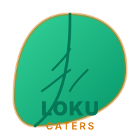
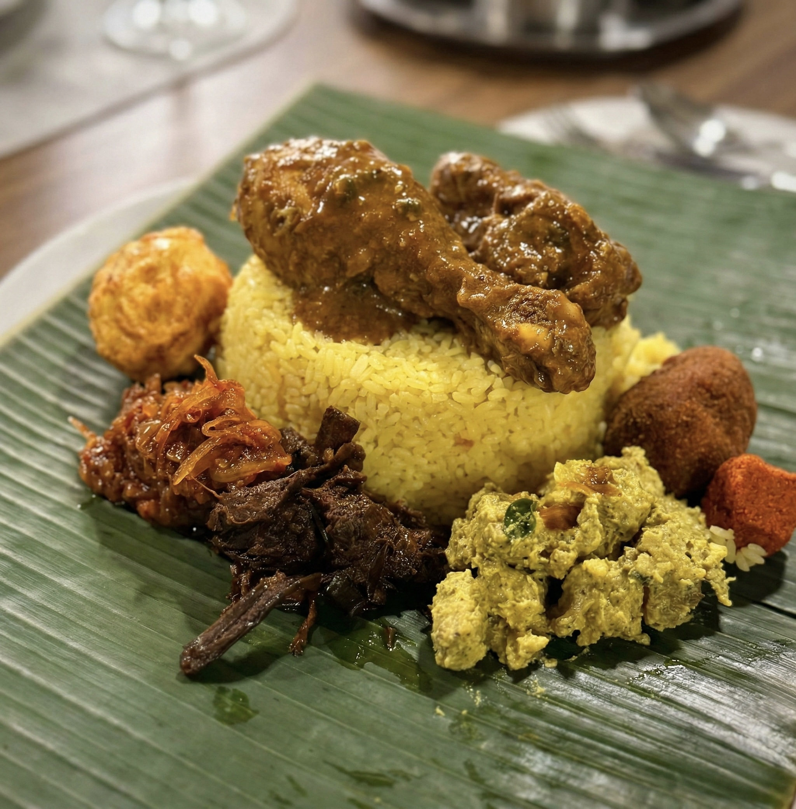

<p align="center">
  
</p>

<h1 align="center">
  <span style="color:#729152">Loku Caters</span>
</h1>

<p align="center">
  <strong>Authentic Sri Lankan Lamprais</strong><br/>
  <em>Heritage Recipes. Small Batches. Made with Love.</em>
</p>

<p align="center">
  
  
  
</p>

---

## About Loku Caters

A family-run catering business sharing authentic Sri Lankan flavors with the Canadian community. Born from a passion for heritage recipes, we craft each dish with the same love and tradition passed down through generations.

### Our Story

**Chef Jayampathi Lokuliyana** brings over **40 years of culinary expertise** to every plate:

- Trained at La Varenne Ecole de Cuisine (France)
- Thai Cooking School of the Oriental Hotel (Bangkok)
- Culinary leadership experience at Intercontinental, Meridian, Sheraton, and Galle Face Hotel
- Awarded Gold, Silver, and Bronze medals in culinary competitions
- Back by popular demand after a 7-year hiatus to share authentic Sri Lankan flavors

### Our Philosophy

| Principle | Description |
|-----------|-------------|
| **Authenticity First** | In-house roasted spice blends and true Sri Lankan recipes passed down through generations |
| **Quality Over Quantity** | Small batches only. Every dish made fresh and never mass-produced |
| **Community Driven** | Pop-up events and catering services that bring people together |

---

## Featured Dish

### Signature Lamprais

Our signature Lamprais is a celebration of flavors, traditionally wrapped in a banana leaf:

<p align="center">
  
</p>

> **What is inside:** Ghee Rice, Baked Chicken Curry, Fried Boiled Egg, Seeni Sambal, Fricadells (Beef and Pork), Ash Plantain Curry, Brinjal Pahie, and Blachan.

---

## Menu Highlights

### Full-Service Catering

| Menu Style | Perfect For | Key Options |
|------------|-------------|-------------|
| **Standard Menu** | Intimate gatherings | Chicken Curry, Fish Ambulthiyal, Dhal Fry, Bringal Moju |
| **Buffet Style** | Parties and events | Garden Salads, Oven Baked Chicken, Spicy Garlic Prawns, Cream Caramel |
| **Classic Curry** | Customizable spreads | Choice of 3 veggie curries, chicken, fish, and prawn options |
| **International Buffet** | Fusion events | Global salads, pastas, roasted herb potatoes, teriyaki prawns, and main curries |
| **Set Menu** | Fine dining | Roasted Beef Striploin or Oven Baked Salmon with Orange Cream Caramel |

### Individual Orders & Specialties

| Category | Popular Choices |
|----------|-----------------|
| **Rice Dishes** | Chicken Biryani with Raita, Ghee Rice |
| **Appetizers** | Fish Cutlets, Fish Rolls, Mutton Rolls, Chicken Rolls |
| **Kids Menu** | Pasta with Chicken and Rose sauce, Meatballs in Tomato sauce, Chicken Fingers |
| **Desserts** | Pineapple Gateau, Marshmallow Pudding, Cream Caramel, Mango Mousse |
| **Specialty Items** | Traditional Sri Lankan Wedding Cakes |

---

## Platform Features

### Customer Experience

- **Frictionless Pre-Ordering:** A single-page checkout flow optimized for mobile and desktop users, with live combo deal pricing.
- **Pickup Logistics:** Location and time slot selection driven by the event config.
- **Owner Notifications:** Every order, catering request, and feedback submission is emailed to the owners through Resend, with reply-to set to the customer.
- **Catering Coordinator:** Dedicated inquiry form for custom catering menu planning.
- **Customer Reviews:** Curated reviews from `config/reviews.json`, plus a form for new ones.

> This `frontend-only` branch runs without a backend, database, or admin portal to keep hosting cost low. The full version with the admin dashboard lives on `main`.

---

## Configuration-Driven Design

All event details, menu items, pickup locations, time slots, combo deals, and pricing live in a single source of truth:

- File: `config/event-config.json` (reviews: `config/reviews.json`)

To open or close pre-orders, edit `active_event` and sync the frontend copy:

```bash
make sync-config
```

See [Running a Pre-Order Event](docs/running-an-event.md) for the full walkthrough.

---

## Tech Stack

- **Framework:** Next.js 15 (TypeScript, App Router), React 19
- **Styling:** Tailwind CSS v4 with CSS custom properties
- **Typography:** Playfair Display (headings) and Inter (body text) via Google Fonts
- **Data:** Static JSON config, no database
- **Email:** Resend REST API called from Next.js route handlers
- **Hosting:** Railway, one Docker service (standalone output, app sleeping enabled)

---

## Local Development Setup

### Prerequisites
- Node.js 20.19 or higher

### Quick Start

```bash
cp .env-example .env   # add Resend credentials to send real notification emails
make dev               # http://localhost:3000
```

### Useful Commands

```bash
make sync-config   # copy config/*.json into the frontend
make test          # pricing unit tests
make build         # production build
```

---

## Design System

Our visual identity reflects the rich, natural heritage of Sri Lankan cuisine:

- **Forest Green (`#12270F`):** Brand primary, used for dark layouts and headers.
- **Sage (`#729152`):** Primary accent color, highlights, and calls to action.
- **Cream (`#F7F5F0`):** Brand neutral, used for page backgrounds and dark text contrast.
- **Text Dark (`#1C1C1A`):** High-contrast body text for maximum readability.

---

## Documentation Directory

- [Running a Pre-Order Event](docs/running-an-event.md)
- [Switching Between the Full and Lite Site](docs/switching-site-modes.md)
- [Tech Stack Overview](docs/tech-stack.md)
- [Menu Configuration](docs/menu.md)

---

<p align="center" style="color:#729152; font-size: 0.9em;">
  <strong>Made with love in Canada</strong><br/>
  Bringing authentic Sri Lankan flavors, one lamprais at a time.
</p>

<p align="center">
  
</p>
